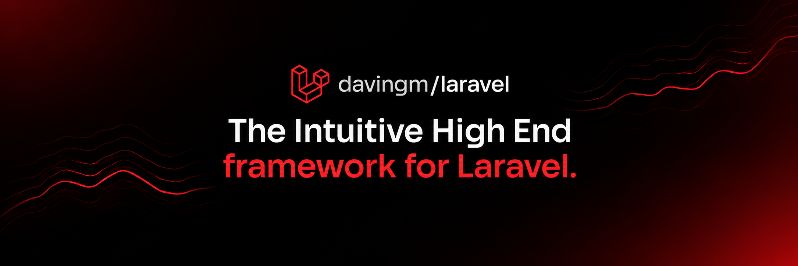

# davingm/laravel

<a href="https://github.com/davingm/laravel"></a>

<p align="center">
  <a href="https://deepwiki.com/davingm/laravel"></a>
  <a href="https://packagist.org/packages/davingm/laravel"></a>
  <a href="https://packagist.org/packages/davingm/laravel"></a>
  <a href="LICENSE"></a>
  <a href="https://www.php.net/"></a>
  <a href="https://laravel.com"></a>
</p>

An early-stage Laravel framework project by [vuxilabs](https://github.com/vuxilabs). It combines a Laravel application with file-based Blade pages, framework generators, and a small server-rendered frontend toolchain.

> [!WARNING]
> **This project is still in its early stages** and continues to evolve. The API, conventions, supporting tools, and documentation are subject to change with each release. Do not assume backward compatibility or production readiness; evaluate the project in an isolated environment, pin the versions you have tested, and ensure it meets your requirements before relying on it. Be sure to read the framework's [License](https://github.com/davingm/laravel/blob/main/LICENSE) before getting started.

## Try the published starter

Create a new application from the published Composer project:

```bash
composer create-project davingm/laravel my-app
cd my-app
```

The starter materializes the application from the package and installs the Composer runtime plugin that generates the ignored `.laravel/` directory. Follow the [installation guide](docs/guidness/02-instalasi.md) for requirements and troubleshooting.

## Develop this repository

This is a monorepo: the framework runtime and its Composer plugin are maintained separately from the Laravel application used to exercise them.

| Path | Purpose |
| --- | --- |
| `packages/laravel/src/` | Composer plugin that installs the framework runtime |
| `packages/laravel/.laravel/` | Editable framework runtime source |
| `playground/` | Laravel application used for development and tests |
| `playground/.laravel/` | Generated runtime copy; do not edit directly |
| `docs/` | User guides, developer documentation, and clearly marked design notes |

### Isolated setup with Dev Containers

1. Install Docker Desktop or another Docker-compatible engine, Visual Studio Code, and its Dev Containers extension.
2. Clone this repository and open its root folder in VS Code.
3. Run **Dev Containers: Reopen in Container** from the Command Palette. The container installs dependencies and prepares `playground/` on first creation.
4. In the container terminal:

   ```bash
   cd playground
   composer run dev
   ```

The development server uses port `8000`. The [Dev Container configuration](.devcontainer/devcontainer.json) is also the reproducible PHP/Composer/Node environment used for local development.

### Setup on your own machine

Requirements: PHP `^8.3`, Composer 2, Node.js and npm. From the repository root:

```bash
cd playground
composer install
npm ci --ignore-scripts
npm run build
artisan key:generate
artisan migrate
composer run dev
```

`composer run dev` starts the Laravel development environment. Use `artisan <command>` for any Artisan command (no need for `php artisan`), such as:

```bash
artisan about
artisan route:list
artisan test
artisan make:dashboard
```

The application source is under `playground/`. The Nuxt-inspired page conventions live in `playground/src/pages` and layouts in `playground/src/layouts`.

## Frontend

The project includes a server-rendered page frontend. Pages are in `src/pages` and shared layouts are in `src/layouts`, relative to `playground/`. Generated frontend manifest and payload files are stored in `playground/.davingm/cache` and ignored by Git.

Build frontend assets from `playground/`:

```bash
node .laravel/cli.js test --compact
npm run build
```

The GitHub Actions workflow also runs the test suite and frontend build, then checks the application through Apache. See [contribution guidelines](CONTRIBUTING.md) for focused checks and pull request expectations.

## Documentation and community


## CLI setup

`composer create-project` installs the global launcher automatically when it is not already installed. You can also install or update it manually:

```bash
npm install --global @davingm/laravel-cli
```

Then use framework commands from the project root or any directory beneath it:

```bash
artisan dev
artisan route:list
artisan make:dashboard
```

The npm package installs a global `artisan` launcher. It finds the nearest framework project and forwards commands to that project's `.laravel/cli.js`; the runtime itself is still installed by Composer. No `artisan` file is added to the project root.

If `artisan` is not found after installation, ensure npm's global executable directory is on `PATH` and open a new terminal. Check the directory with `npm prefix --global`.

## Requirements

- PHP >= 8.3
- Composer
- Node.js >= 18

## License

The current project source is licensed under the [GNU Affero General Public License v3.0](LICENSE) (`AGPL-3.0-only`). Third-party dependencies and materials retain their respective licenses. Earlier published releases may carry different, historical license metadata; changing the source branch does not change the license attached to an existing release.

Packagist derives metadata from each tag and branch's own `composer.json`; changing `main` does not rewrite metadata for existing releases or branches. After a tag or branch is changed or removed, Packagist and Composer may still show cached metadata. Refresh the package on Packagist and run `composer clear-cache` locally before diagnosing a mismatch. Check the exact version or branch you install if its registry metadata matters to you.
